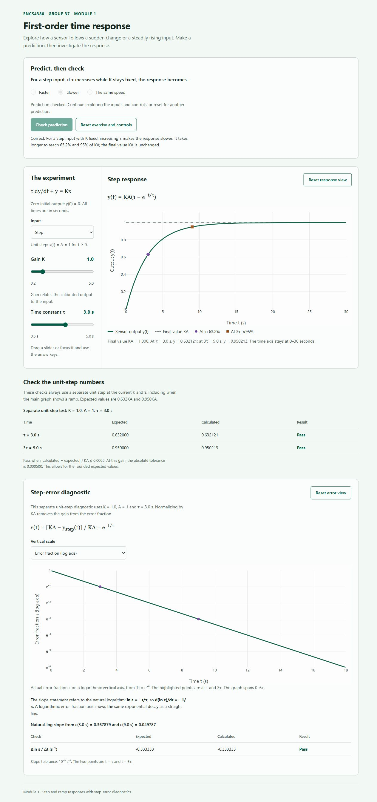
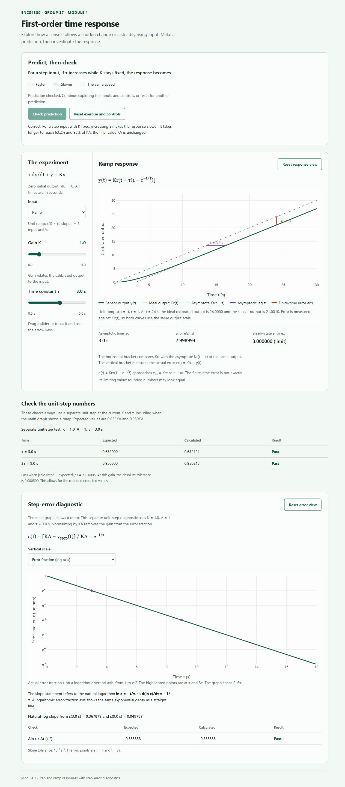
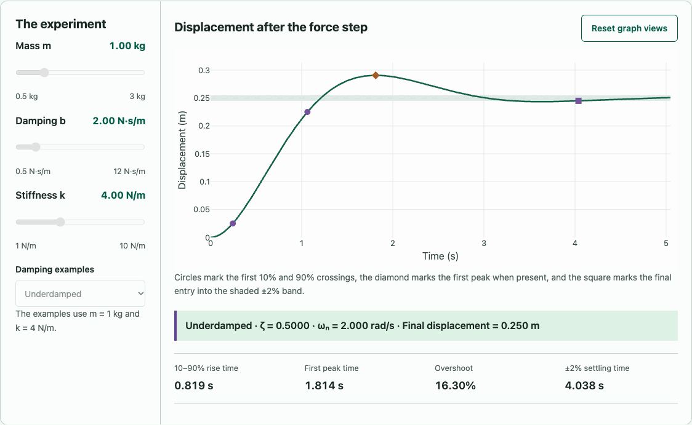
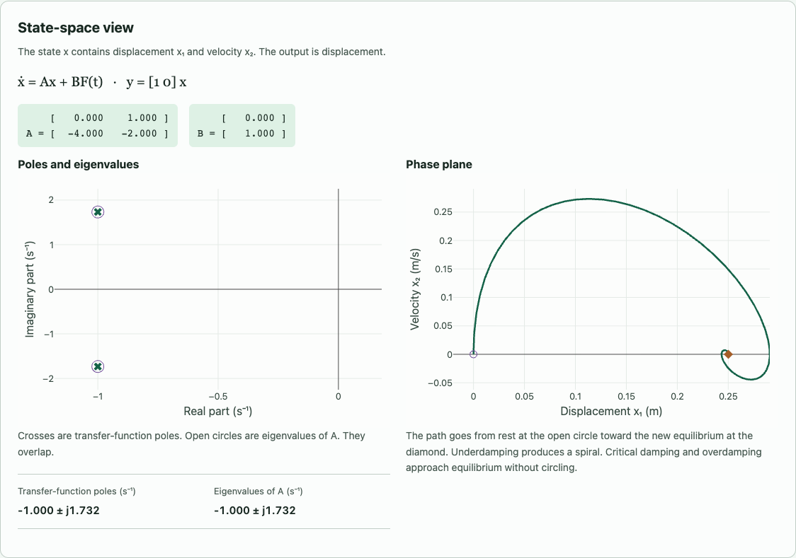

# ENCS4380 Dynamic Characteristics Toolkit - Group 37

An interactive toolkit for exploring sensor dynamics. Modules 1 and 2 cover first-order time and frequency responses. Module 3 explores a second-order mass-spring-damper in the time, phase, and s-planes.

**Live website:** [Open the Dynamic Characteristics Toolkit](https://mohammad-sawafta.github.io/encs4380-dynamics-Group37/).

The [source repository](https://github.com/Mohammad-Sawafta/encs4380-dynamics-Group37) publishes through GitHub Pages. Open the live website in a desktop or phone browser. An internet connection is needed to load Plotly.js; no account or installation is required.

## Use Module 1

1. Choose a prediction before moving the experiment controls.
2. Increase the time constant while keeping K fixed and Step selected, then check your prediction.
3. Explore gain K and switch between a step and a ramp input.
4. Inspect the response markers, ramp lag, and dynamic error.
5. Switch the step-error diagnostic between a logarithmic error axis and a natural-log plot.
6. Read the expected values, calculated values, and pass/fail results.

The step amplitude is A = 1 input unit. The ramp slope is r = 1 input unit per second. The initial output is zero. Time is measured in seconds, and the controls use positive gain and a positive time constant.

## Use Module 2

1. Choose a prediction about how increasing frequency changes amplitude and phase lag.
2. Increase angular frequency `omega` while keeping `tau` fixed, then check the prediction.
3. Compare the unit-amplitude input with the attenuated, phase-lagged steady-state output.
4. Read `tau`, `omega`, frequency in hertz, amplitude ratio, and phase in degrees and radians.
5. Inspect the current-frequency and cutoff markers on the logarithmic Bode plots.
6. Use the dynamic-error and maximum-permissible-time-constant calculators.
7. Review homework validations 2 and 3.

Module 2 uses `K = 1`, so the actual output/input amplitude ratio equals the normalized ratio `M`. The sine-wave graph shows the steady-state response and excludes the startup transient.

## Use Module 3

1. Predict how increasing damping changes overshoot. Increase b from its default while keeping m = 1 kg and k = 4 N/m, then check your prediction.
2. Explore the m, b, and k sliders or select the underdamped, critically damped, and overdamped examples.
3. Read the first 10% and 90% crossings, first peak, and final entry into the ±2% band on the step plot. The live metrics report the time between the two rise crossings, peak time, percent overshoot, and settling time.
4. Compare the eigenvalues of A with the transfer-function poles, then follow the displacement–velocity trajectory from rest to equilibrium.
5. Review the expected and calculated values in homework validations 4–6.

The input is a 1 N force step and the mass starts at rest. The model uses `G(s) = 1/(m*s^2 + b*s + k)` with `omega_n = sqrt(k/m)`, `zeta = b/(2*sqrt(m*k))`, and final displacement `1/k`. For state `[displacement, velocity]`, `A = [[0, 1], [-k/m, -b/m]]` and `B = [0, 1/m]`. The phase trajectory uses the same closed-form displacement and its time derivative. Critical and overdamped responses approach equilibrium monotonically and have zero overshoot.

## First-order equations and interpretation

The homework's model is `tau * dy/dt + y = K * x(t)`.

| Quantity | Formula |
| --- | --- |
| Step input | `x(t) = A` for `t >= 0` |
| Step output | `y(t) = K*A*(1 - exp(-t/tau))` |
| Ramp input | `x(t) = r*t` |
| Ideal calibrated ramp output | `K*x(t) = K*r*t` |
| Actual ramp output | `y(t) = K*r*(t - tau*(1 - exp(-t/tau)))` |
| Ramp asymptote | `K*r*(t - tau)` |
| Ramp dynamic error | `e(t) = K*x(t) - y(t) = K*r*tau*(1 - exp(-t/tau))` |
| Steady-state ramp error | `e_ss = K*r*tau` |
| Asymptotic ramp time lag | `tau` |
| Step error fraction | `epsilon = (K*A - y_step)/(K*A) = exp(-t/tau)` |
| Natural log of step error | `ln(epsilon) = -t/tau` |
| Frequency transfer function | `G(s) = K/(tau*s + 1)` |
| Normalized amplitude ratio | `M = 1/sqrt(1 + (omega*tau)^2)` |
| Phase shift | `phi = -atan(omega*tau)` |
| Frequency conversion | `f = omega/(2*pi)` |
| Bode magnitude | `20*log10(M)` dB |
| Cutoff angular frequency | `omega_c = 1/tau` |
| Signed frequency dynamic error | `delta = M - 1` |
| Positive attenuation magnitude | `e = 1 - M = abs(delta)` |
| Maximum permissible time constant | `tau_max = sqrt(1/(1-e)^2 - 1)/(2*pi*f_max)` |

The ramp error compares the measured output with **K times the input**. Subtracting the raw input from the output would mix gain error with dynamic lag when K differs from 1. A ramp does not have a finite final output; its error approaches the steady-state value while both ideal and actual outputs keep increasing.

For Module 2, `delta` is signed and is normally negative because a first-order sensor attenuates a sinusoid. The design limit uses the positive magnitude `e = 1 - M`. At cutoff, `M = 1/sqrt(2) = 0.7071`, magnitude is `-3.0103 dB`, and phase is `-45 degrees`.

The logarithmic diagnostic uses a separate unit-step experiment at the current K and tau, even when the main graph shows a ramp. The slope `-1/tau` refers to **ln(epsilon)** versus physical time. A plot of `log10(epsilon)` would instead have slope `-1/(tau*ln(10))`.

## Validation

Homework validation check 1 is shown on the page:

- `y(tau) / (K*A) = 0.6321205588`, approximately 0.632.
- `y(3*tau) / (K*A) = 0.9502129316`, approximately 0.95.

Module 2 validation results:

- Validation 2 (`tau = 0.2 s`, `omega = 2 rad/s`): `M = 0.92847669` and phase-lag magnitude `21.8014 degrees`.
- Validation 3 (`f_max = 100 Hz`, `e = 5%`): `tau_max = 0.523117 ms` and phase-lag magnitude at `50 Hz = 9.3327 degrees`.

Module 3 validation results:

- Validation 4 (`zeta = 0.5`) gives 16.30% overshoot.
- Validation 5 (`zeta = 1`) gives 0% overshoot.
- Validation 6 (`m = 1, b = 2, k = 4`) gives eigenvalues and poles of approximately `-1 ± j1.732 s^-1`.

Run all numerical checks with Node.js.

```sh
node --test tests/*.test.cjs
```

The Module 1 suite contains 470 numerical assertions. The Module 2 suite contains 124 assertions covering amplitude ratio, phase, conversions, Bode magnitude, cutoff, dynamic error, design limits, low/high-frequency behavior, numerical stability, and homework validations 2 and 3. The Module 3 suite compares displacement and velocity against independent RK4 integration across all three regimes and checks the timing metrics, poles, and homework validations 4–6.

## File responsibilities

| File | Responsibility |
| --- | --- |
| `index.html` | Content, controls, graph containers, and script loading |
| `css/styles.css` | Shared styling and responsive layout |
| `js/models/first-order.js` | Reusable equations, independent of the page and Plotly |
| `js/models/frequency-response.js` | Pure frequency-response and design-limit equations |
| `js/models/second-order.js` | Closed-form mass-spring-damper response, timing metrics, and eigenvalues |
| `js/plotting.js` | Shared Plotly styling, rendering, and reset helpers |
| `js/module1.js` | Module 1 controls, graph data, prediction, and validation |
| `js/module2.js` | Module 2 controls, graphs, calculators, prediction, and validation |
| `js/module3.js` | Module 3 sliders, plots, state-space panel, prediction, and validation |
| `tests/first-order.test.cjs` | Independent Module 1 numerical verification |
| `tests/frequency-response.test.cjs` | Module 2 equation and validation tests |
| `tests/second-order.test.cjs` | Module 3 response, timing, and validation tests |

## Group members and module ownership

- [Mohammad-Sawafta](https://github.com/Mohammad-Sawafta)
- [Yanal Omar (yaniomar)](https://github.com/yaniomar)
- [Saifeddin Saleh (saifsaleh05)](https://github.com/saifsaleh05)

| Module | Owner | Status |
| --- | --- | --- |
| Module 1 - first-order time response | Mohammad | Published |
| Module 2 - first-order frequency response | Yanal | Implemented with interactive graphs, calculators, validations, and tests |
| Module 3 - second-order response and state-space panel | Saif | Implemented with interactive plots, live matrices, validations, and tests |
| Module 4 - Guess the Sensor challenge | Mohammad | Planned for the final release |

## Screenshots









## AI assistance

AI assistance helped draft the interface and JavaScript, check equations, and prepare numerical tests. Module 2 reinforced the distinction between signed dynamic error and positive attenuation magnitude, the meaning of the `-3.01 dB` cutoff, and how `omega*tau` controls both amplitude and phase.

For Module 3, AI assistance was used to implement the second-order model, controls, state-space plots, and numerical tests.
