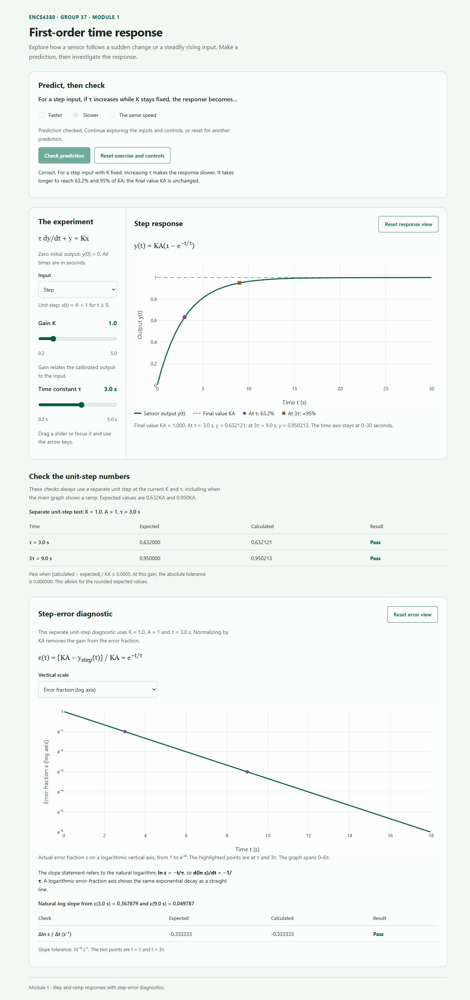
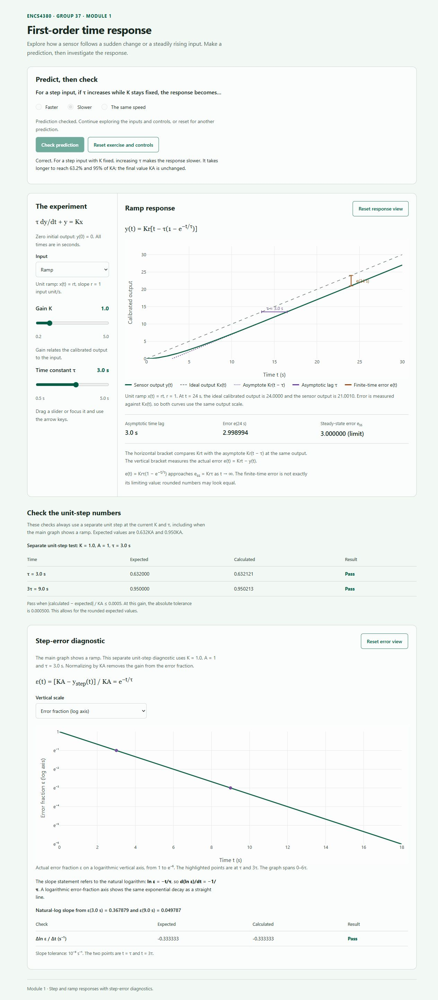
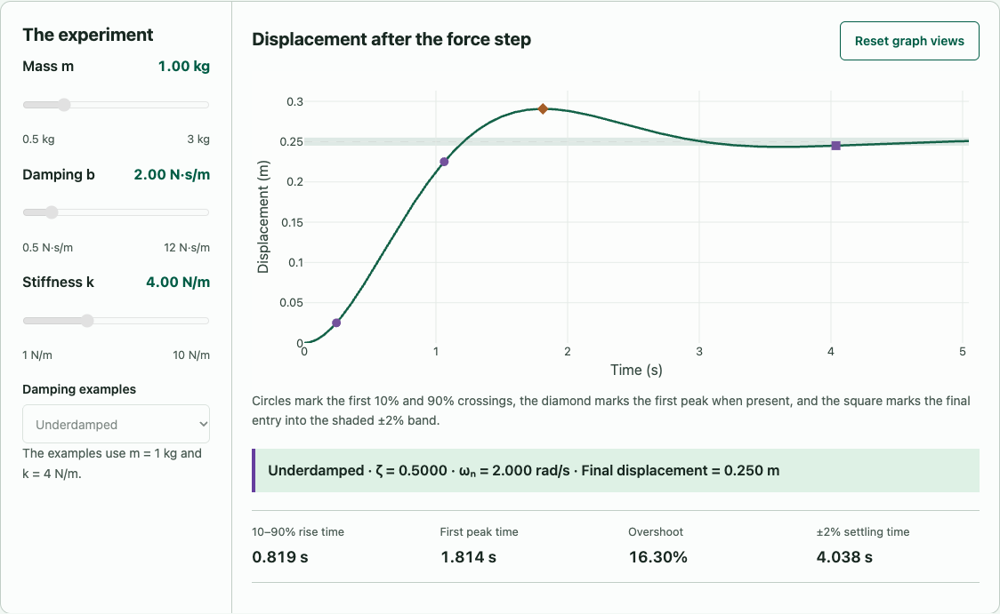
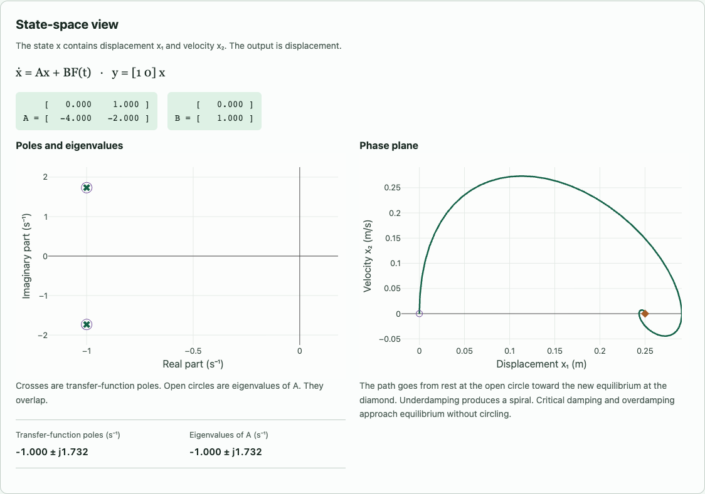
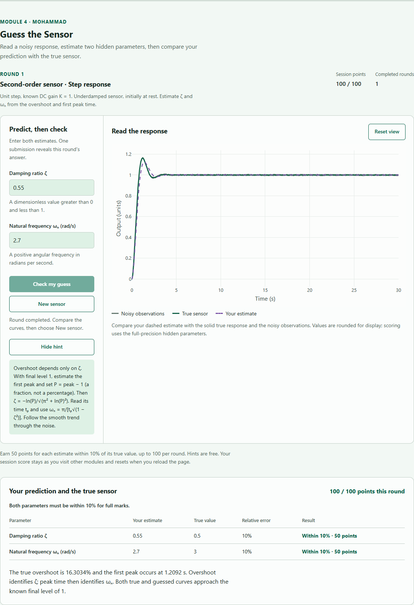

# ENCS4380 Dynamic Characteristics Toolkit - Group 37

An interactive toolkit for exploring sensor dynamics. Modules 1 and 2 cover first-order time and frequency responses. Module 3 explores a second-order mass-spring-damper in the time, phase, and s-planes.

Module 4 adds a Guess the Sensor challenge with noisy responses, parameter estimates, hints, session scoring, and a reveal comparison.

**Live website:** [Open the Dynamic Characteristics Toolkit](https://mohammad-sawafta.github.io/encs4380-dynamics-Group37/).

The [source repository](https://github.com/Mohammad-Sawafta/encs4380-dynamics-Group37) publishes through GitHub Pages. Open the live website in a desktop or phone browser. An internet connection is needed to load Plotly.js; no account or installation is required.

To run the toolkit locally, serve this checkout with `python -m http.server 8765 --bind 127.0.0.1` and open [the local challenge](http://127.0.0.1:8765/#module4). If that local server is already running, open the link directly.

## Homework 2: Control

Open the five Homework 2 pages from the **Control** and **My System** links on the landing page.
P1 provides first-order and mass-spring-damper plants, live Kp/Ki/Kd controls,
setpoint and actuator limits, a feedback diagram, output and control-effort
graphs, response metrics, prediction feedback, and three homework validations.
The P, PI, PID and unreachable-target presets give reproducible starting points.

P2 inserts a first-order sensor in the feedback path. It plots true output,
sensor-reported output and setpoint together, while the controller uses only the
sensor report. Four presets move from ideal feedback through growing lag to an
unstable oscillation without changing the PID gains. The ideal `tau_s = 0` case
bypasses the sensor algebraically and reproduces P1 exactly.

P3 implements the assignment's sampled PID equation with a zero-order-held
stair-step command, adjustable sampling time, conditional anti-windup, and
Arduino code generated from the current settings. Its presets show the same
gains moving from fast sampling to unstable sampled behavior.

P4 draws a hidden random first-order plant and scores PID gains independently
against overshoot, settling-time, and steady-state-error limits. A plant stays
fixed across retries, can be revealed after an attempt, and is replaced only
when the user starts a new challenge.

My System applies the shared sampled PID model to a Micromouse drive motor. It
accepts timestamped encoder-speed measurements from a real PWM step test,
handles nonzero input and speed baselines, estimates `K` from the actual PWM
change, interpolates the 63.2% crossing for `tau`, and compares entered samples
with a first-order fit. It then simulates 0-100% PWM control, scores motor-scaled
time-domain specifications, reports a mathematically derived continuous-model
damping approximation, and generates hardware-neutral Arduino integration
code. Its built-in demonstration dataset is explicitly synthetic and is not a
hardware measurement.

| Homework 2 module | Owner | Status |
| --- | --- | --- |
| P1 - PID playground | Mohammad | Implemented |
| P2 - Slow sensor in the loop | Saif | Implemented |
| P3 - Digital PID | Saif | Implemented |
| P4 - Tuning challenge | Saif | Implemented |
| My system - Micromouse motor speed loop | Yanal Omar (`yaniomar`) | Implemented; real measurements and physical validation still required |

The simulation uses RK4 on the full plant/controller state. Both plant equations
are preserved from Homework 1. The requested command is clipped before it
drives the plant. Derivative action uses the measured output with a 0.02 s
first-order filter, avoiding a setpoint kick. P1 intentionally has no anti-windup;
P3 must add its own anti-windup and sampled-controller behavior.

Rise time is the first 10-90% setpoint crossing interval. Overshoot and the 2%
settling band also refer to the target, so a biased P-only output can be flat
without being settled to the target. Metrics observe every integration step;
crossing times are interpolated independently of the sparse plot samples.
Shorten the display duration to inspect very fast responses on the plots.
Timing metrics are undefined for a zero
step. Error is estimated from the last 15% only if the output varies by at most
`0.0001 * max(1, abs(setpoint))`; otherwise the page reports the final-window
error separately. A finite simulation cannot guarantee future settling.

`tests/pid-control.test.cjs` compares first-order P and PI against exact curves,
second-order P against the existing mechanical model, checks signed/zero steps
and actuator saturation, verifies smaller-step convergence for filtered D,
and rejects invalid input or excessive numerical work.
Regression checks cover fast responses across display durations and sample
counts, overshoot peaks between plot samples, and final settling-band entry.

`tests/pid-sensor.test.cjs` verifies the sensor differential equation against an
independent RK4 reference, proves the zero-lag bypass is identical to P1, checks
that sensor lag increases overshoot and produces growing oscillation, and covers
second-order plants, saturation, invalid input, and solver-step convergence.

`tests/digital-pid.test.cjs` checks the discrete assignment equation, uniform
sample instants, zero-order hold behavior, convergence toward continuous PI at
small Ts, instability at large Ts, conditional anti-windup, saturation, and the
generated Arduino loop. `tests/pid-tuning-challenge.test.cjs` covers random-plant
bounds, input validation, independent scoring, and feasible designs across the
entire hidden-plant range.

The P1 review on 21 November checked the assignment requirements and fixed
metrics that previously depended on plot sampling. Browser interaction and
phone-layout verification remain pending: the review environment could not
reach the local preview server.

The P2 review on 21 November exercised every preset and the prediction flow in
a real browser, confirmed both Plotly graphs render without console errors, and
checked desktop and narrow phone layouts for horizontal overflow.

The P3/P4 review on 22 November exercised sampled-instability and anti-windup
presets, generated-code copying, challenge retries, reveal and full-score paths,
and responsive desktop and 360-pixel layouts without console errors or page
overflow.

### My System: Micromouse drive motor

Owner: **Yanal Omar (`yaniomar`)**.

The motor is modeled over one operating region as
`G(s) = K/(tau*s + 1)`, with speed in RPM and PWM command in percent. Real
parameters must come from a step experiment: record baseline PWM and steady
speed, apply and hold a different PWM command, and calculate
`K = (steady speed - baseline speed)/(step PWM - baseline PWM)`. The time
constant is measured from the interpolated time at which speed reaches 63.2% of
its total change. Encoder counts must be converted with the robot's actual
encoder resolution and gearing; those hardware values are deliberately not
invented in this repository.

The controller reuses `DigitalPIDModel`, so the browser simulation and generated
Arduino loop use the same sampled PID equation, zero-order hold, 0-100% command
clipping, and conditional anti-windup. The generated code exposes
`readEncoderSpeedRPM()` and `writeMotorPWMPercent()` as integration points;
board pins, interrupt setup, encoder resolution, gearing, direction handling,
motor-driver APIs, and electrical safety limits must be configured on the real
Micromouse.

The design limits are derived from the identified operating point rather than
claimed as universal hardware limits: rise time is at most
`max(0.15 s, 1.5*tau)`, overshoot at most 10%, settling time at most
`max(0.5 s, 4*tau)`, and steady-state error at most
`max(1 RPM, 2% of target)`. The recommended damping band is `0.6 <= zeta <= 0.8`.
For the ideal continuous linear PID model, the characteristic polynomial is
`(tau + K*Kd)*s^2 + (1 + K*Kp)*s + K*Ki`; therefore
`wn = sqrt(K*Ki/(tau + K*Kd))` and
`zeta = (1 + K*Kp)/(2*sqrt((tau + K*Kd)*K*Ki))` when `Ki > 0`.
This damping value is labeled as an approximation because sampling, saturation,
anti-windup, real motor nonlinearities, and measurement noise are not part of
that derivation. The time-domain pass/fail table uses the sampled simulation.

Default demonstration controller settings are `K = 3 RPM/% PWM`, `tau = 0.35 s`,
target `180 RPM`, `Kp = 0.7`, `Ki = 2 1/s`, `Kd = 0`, and `Ts = 0.02 s`.
These are workflow examples, not final gains supported by physical motor data.
Final identified parameters, gains, results, and physical validation remain
blocked until Group 37 performs and records the real motor test.

The [P1/P2 handoff](docs/plans/2026-11-21-pid-p1-p2-handoff.md) documents the
shared functions, sensor-state extension and remaining submission tasks.
Generic plants are examples, not measured micromouse motor parameters.

AI assistance supported the P1 equations, implementation, numerical tests and
handoff documentation. Each group member must understand and explain their
own code and equations in the demo.

## Use Module 1

1. Choose a prediction before moving the experiment controls.
2. Increase the time constant while keeping K fixed and Step selected, then check your prediction.
3. Explore gain K and switch between a step and a ramp input.
4. Inspect the response markers, ramp lag, and dynamic error.
5. Switch the step-error diagnostic between a logarithmic error axis and a natural-log plot.
6. Read the expected values, calculated values, and pass/fail results.

The step amplitude is A = 1 input unit. The ramp slope is r = 1 input unit per second. The initial output is zero. Time is measured in seconds, and the controls use positive gain and a positive time constant.

## Use Module 2

1. Choose a prediction about how increasing frequency changes amplitude and phase lag.
2. Increase angular frequency `omega` while keeping `tau` fixed, then check the prediction.
3. Compare the unit-amplitude input with the attenuated, phase-lagged steady-state output.
4. Read `tau`, `omega`, frequency in hertz, amplitude ratio, and phase in degrees and radians.
5. Inspect the current-frequency and cutoff markers on the logarithmic Bode plots.
6. Use the dynamic-error and maximum-permissible-time-constant calculators.
7. Review homework validations 2 and 3.

Module 2 uses `K = 1`, so the actual output/input amplitude ratio equals the normalized ratio `M`. The sine-wave graph shows the steady-state response and excludes the startup transient.

## Use Module 3

1. Predict how increasing damping changes overshoot. Increase b from its default while keeping m = 1 kg and k = 4 N/m, then check your prediction.
2. Explore the m, b, and k sliders or select the underdamped, critically damped, and overdamped examples.
3. Read the first 10% and 90% crossings, first peak, and final entry into the ±2% band on the step plot. The live metrics report the time between the two rise crossings, peak time, percent overshoot, and settling time.
4. Compare the eigenvalues of A with the transfer-function poles, then follow the displacement–velocity trajectory from rest to equilibrium.
5. Review the expected and calculated values in homework validations 4–6.

The input is a 1 N force step and the mass starts at rest. The model uses `G(s) = 1/(m*s^2 + b*s + k)` with `omega_n = sqrt(k/m)`, `zeta = b/(2*sqrt(m*k))`, and final displacement `1/k`. For state `[displacement, velocity]`, `A = [[0, 1], [-k/m, -b/m]]` and `B = [0, 1/m]`. The phase trajectory uses the same closed-form displacement and its time derivative. Critical and overdamped responses approach equilibrium monotonically and have zero overshoot.

## Use Module 4

1. Open **Module 4 · Guess the Sensor**. A random sensor and its noisy response load automatically.
2. Read the known input conditions. Estimate `K` and `tau` for first-order step or sine rounds, or `zeta` and `omega_n` for second-order step rounds.
3. Inspect the graph with hover and zoom; **Reset view** restores its original axes. **Show hint** explains the estimating method without a score penalty.
4. Enter both estimates and select **Check my guess**. Invalid entries can be corrected without revealing or scoring the round.
5. Compare the revealed values and relative errors. The graph overlays your predicted response and the clean true response on the original noisy observations.
6. Select **New sensor** after a valid submission to continue. The next round clears estimates, hints, and the reveal while retaining session totals.

Each parameter earns 50 points when its relative error is at most 10%, including exactly 10%; otherwise it earns zero. A round earns 0, 50, or 100 points. Relative error is `100*abs(estimate - true)/abs(true)`, calculated from unrounded values. There is one scored guess per round. Hints, invalid inputs, graph inspection, and graph retries do not change scores. Navigating between modules keeps the session; reloading the page resets it.

The approved challenge settings are:

| Setting | Value |
| --- | --- |
| Round selection | 40% first-order step, 20% first-order sine, 40% second-order step |
| First-order parameters | `0.5 <= K <= 3.0`; `0.5 <= tau <= 3.0` seconds |
| Second-order parameters | `0.20 <= zeta <= 0.70`; `1.0 <= omega_n <= 5.0` rad/s |
| Sine frequency | Equally likely `omega = 0.5`, `1`, or `2` rad/s; four steady-state periods |
| Step observation time | 0-24 seconds for first order; 0-30 seconds for second order |
| Measurement noise | Independent uniform noise bounded by ±1% of the clean final level for steps, or output amplitude for sine rounds |

Parameters are sampled uniformly within each range. Noise is generated once per round and stays unchanged during inspection and reveal. Estimates may fall outside the generation ranges: `K`, `tau`, and `omega_n` must be positive and finite; `zeta` must satisfy `0 < zeta < 1`. Values whose derived responses cannot be represented numerically are rejected without scoring.

### Module 4 equations and identification

First-order step rounds use a unit input and `y(t) = K*(1 - exp(-t/tau))`. Read `K` from the final level and `tau` from the time to reach 63.2% of that level.

First-order sine rounds use `x(t) = sin(omega*t)` and `y(t) = K/sqrt(1 + (omega*tau)^2) * sin(omega*t - atan(omega*tau))`. This is the steady-state response, without a startup transient. For output amplitude `B` and lag `phi = omega*delta_t` in radians, estimate `tau = tan(phi)/omega` and `K = B*sqrt(1 + (omega*tau)^2)`.

Second-order rounds use the unit-DC-gain model `G(s) = omega_n^2/(s^2 + 2*zeta*omega_n*s + omega_n^2)` and start from rest. They reuse the mechanical model with `m = 1`, `b = 2*zeta*omega_n`, and `k = omega_n^2`, dividing its displacement by its final displacement `1/k`. Consequently the challenge's clean output approaches one asymptotically. For fractional overshoot `P = first_peak - 1`, estimate `zeta = -ln(P)/sqrt(pi^2 + ln(P)^2)` and `omega_n = pi/(t_peak*sqrt(1 - zeta^2))`. The underdamped generation range keeps a peak available for this method.

True and guessed curves use the same closed-form equations. Noise changes only the observations, never the scoring reference or either clean curve.

## First-order equations and interpretation

The homework's model is `tau * dy/dt + y = K * x(t)`.

| Quantity | Formula |
| --- | --- |
| Step input | `x(t) = A` for `t >= 0` |
| Step output | `y(t) = K*A*(1 - exp(-t/tau))` |
| Ramp input | `x(t) = r*t` |
| Ideal calibrated ramp output | `K*x(t) = K*r*t` |
| Actual ramp output | `y(t) = K*r*(t - tau*(1 - exp(-t/tau)))` |
| Ramp asymptote | `K*r*(t - tau)` |
| Ramp dynamic error | `e(t) = K*x(t) - y(t) = K*r*tau*(1 - exp(-t/tau))` |
| Steady-state ramp error | `e_ss = K*r*tau` |
| Asymptotic ramp time lag | `tau` |
| Step error fraction | `epsilon = (K*A - y_step)/(K*A) = exp(-t/tau)` |
| Natural log of step error | `ln(epsilon) = -t/tau` |
| Frequency transfer function | `G(s) = K/(tau*s + 1)` |
| Normalized amplitude ratio | `M = 1/sqrt(1 + (omega*tau)^2)` |
| Phase shift | `phi = -atan(omega*tau)` |
| Frequency conversion | `f = omega/(2*pi)` |
| Bode magnitude | `20*log10(M)` dB |
| Cutoff angular frequency | `omega_c = 1/tau` |
| Signed frequency dynamic error | `delta = M - 1` |
| Positive attenuation magnitude | `e = 1 - M = abs(delta)` |
| Maximum permissible time constant | `tau_max = sqrt(1/(1-e)^2 - 1)/(2*pi*f_max)` |

The ramp error compares the measured output with **K times the input**. Subtracting the raw input from the output would mix gain error with dynamic lag when K differs from 1. A ramp does not have a finite final output; its error approaches the steady-state value while both ideal and actual outputs keep increasing.

For Module 2, `delta` is signed and is normally negative because a first-order sensor attenuates a sinusoid. The design limit uses the positive magnitude `e = 1 - M`. At cutoff, `M = 1/sqrt(2) = 0.7071`, magnitude is `-3.0103 dB`, and phase is `-45 degrees`.

The logarithmic diagnostic uses a separate unit-step experiment at the current K and tau, even when the main graph shows a ramp. The slope `-1/tau` refers to **ln(epsilon)** versus physical time. A plot of `log10(epsilon)` would instead have slope `-1/(tau*ln(10))`.

## Validation

Homework validation check 1 is shown on the page:

- `y(tau) / (K*A) = 0.6321205588`, approximately 0.632.
- `y(3*tau) / (K*A) = 0.9502129316`, approximately 0.95.

Module 2 validation results:

- Validation 2 (`tau = 0.2 s`, `omega = 2 rad/s`): `M = 0.92847669` and phase-lag magnitude `21.8014 degrees`.
- Validation 3 (`f_max = 100 Hz`, `e = 5%`): `tau_max = 0.523117 ms` and phase-lag magnitude at `50 Hz = 9.3327 degrees`.

Module 3 validation results:

- Validation 4 (`zeta = 0.5`) gives 16.30% overshoot.
- Validation 5 (`zeta = 1`) gives 0% overshoot.
- Validation 6 (`m = 1, b = 2, k = 4`) gives eigenvalues and poles of approximately `-1 ± j1.732 s^-1`.

Run all numerical checks with Node.js.

```sh
node --test tests/*.test.cjs
```

The Module 1 suite contains 470 numerical assertions. The Module 2 suite contains 124 assertions covering amplitude ratio, phase, conversions, Bode magnitude, cutoff, dynamic error, design limits, low/high-frequency behavior, numerical stability, and homework validations 2 and 3. The Module 3 suite compares displacement and velocity against independent RK4 integration across all three regimes and checks the timing metrics, poles, and homework validations 4–6.

The Module 4 suite covers deterministic sensor generation, parameter ranges, closed-form responses, second-order normalization, noise bounds and stability, inclusive scoring boundaries, input validation, and single-submission session totals. All 49 Node test cases reported across the toolkit pass, including eight Micromouse identification and control cases.

Local Chrome verification passed 52 browser checks covering all three challenge types, hidden answers, invalid inputs, 0/50/100 scoring, repeated submission, new rounds, graph loading and rendering recovery, keyboard navigation, 360-pixel layout, and the existing modules' prediction interactions and six homework validations. Desktop and phone screenshots were visually reviewed.

## File responsibilities

| File | Responsibility |
| --- | --- |
| `index.html` | Content, controls, graph containers, and script loading |
| `css/styles.css` | Shared styling and responsive layout |
| `js/models/first-order.js` | Reusable equations, independent of the page and Plotly |
| `js/models/frequency-response.js` | Pure frequency-response and design-limit equations |
| `js/models/second-order.js` | Closed-form mass-spring-damper response, timing metrics, and eigenvalues |
| `js/models/sensor-challenge.js` | Pure sensor generation, fixed noise, response adaptation, input validation, scoring, and session state |
| `js/models/pid-control.js` | Continuous PID, plant integration, saturation, and response metrics for P1 |
| `js/models/pid-sensor.js` | First-order sensor state inside the PID feedback loop for P2 |
| `js/models/digital-pid.js` | Sampled PID, zero-order hold, conditional anti-windup, and Arduino generation for P3 |
| `js/models/pid-tuning-challenge.js` | Hidden random plant generation and three-part specification scoring for P4 |
| `js/models/micromouse-system.js` | Motor-data parsing, first-order identification, motor specifications, shared sampled simulation, and Arduino adaptation |
| `js/plotting.js` | Shared Plotly styling, rendering, and reset helpers |
| `js/module1.js` | Module 1 controls, graph data, prediction, and validation |
| `js/module2.js` | Module 2 controls, graphs, calculators, prediction, and validation |
| `js/module3.js` | Module 3 sliders, plots, state-space panel, prediction, and validation |
| `js/module4.js` | Module 4 estimates, hints, reveal graphs, recovery, and session feedback |
| `js/control-p1.js` | P1 controls, presets, plots, metrics, and validation display |
| `js/control-p2.js` | P2 sensor-lag controls, presets, plots, prediction, and diagnostics |
| `js/control-p3.js` | P3 sampling, anti-windup, stair-step plots, prediction, and code-copy interaction |
| `js/control-p4.js` | P4 hidden-plant attempts, score table, reveal, plots, and prediction interaction |
| `js/my-system.js` | Micromouse identification, plots, controller checks, prediction exercise, and code-copy interaction |
| `tests/first-order.test.cjs` | Independent Module 1 numerical verification |
| `tests/frequency-response.test.cjs` | Module 2 equation and validation tests |
| `tests/second-order.test.cjs` | Module 3 response, timing, and validation tests |
| `tests/sensor-challenge.test.cjs` | Module 4 generation, numerical, scoring, and session tests |
| `tests/pid-control.test.cjs` | P1 analytical comparisons, metrics, saturation, and convergence tests |
| `tests/pid-sensor.test.cjs` | P2 sensor dynamics, lag, oscillation, and bypass tests |
| `tests/digital-pid.test.cjs` | P3 discrete equation, sampling, anti-windup, and generated-code tests |
| `tests/pid-tuning-challenge.test.cjs` | P4 random range, feasibility, validation, and scoring tests |
| `tests/micromouse-system.test.cjs` | Baseline-aware identification, motor limits, damping derivation, scaled specifications, and generated-code tests |

## Group members and module ownership

- [Mohammad-Sawafta](https://github.com/Mohammad-Sawafta)
- [Yanal Omar (yaniomar)](https://github.com/yaniomar)
- [Saifeddin Saleh (saifsaleh05)](https://github.com/saifsaleh05)

| Module | Owner | Status |
| --- | --- | --- |
| Module 1 - first-order time response | Mohammad | Published |
| Module 2 - first-order frequency response | Yanal | Implemented with interactive graphs, calculators, validations, and tests |
| Module 3 - second-order response and state-space panel | Saif | Implemented with interactive plots, live matrices, validations, and tests |
| Module 4 - Guess the Sensor challenge | Mohammad | Implemented with random sensors, hints, scoring, reveal overlays, and tests |
| Homework 2 P1 - PID playground | Mohammad | Implemented with continuous PID, actuator limits, metrics, and tests |
| Homework 2 P2 - slow sensor in the loop | Saif | Implemented with delayed feedback, oscillation presets, and tests |
| Homework 2 P3 - digital PID | Saif | Implemented with sampling, anti-windup, Arduino code, and tests |
| Homework 2 P4 - tuning challenge | Saif | Implemented with hidden plants, specification scoring, and tests |
| Homework 2 My System - Micromouse motor speed control | Yanal Omar | Implemented and numerically tested; real motor measurements remain required |

## Screenshots











## AI assistance

AI assistance helped draft the interface and JavaScript, check equations, and prepare numerical tests. Module 2 reinforced the distinction between signed dynamic error and positive attenuation magnitude, the meaning of the `-3.01 dB` cutoff, and how `omega*tau` controls both amplitude and phase.

For Module 3, AI assistance was used to implement the second-order model, controls, state-space plots, and numerical tests.

For Module 4, AI assistance supported the approved requirements, challenge implementation, and numerical checks. The work reinforced estimating gain and time constant from amplitude and lag, normalizing the second-order final value, and scoring parameter error independently of measurement noise.

For Homework 2 P2, AI assistance supported the coupled plant-sensor-PID RK4
model, the slow-sensor teaching interaction, and numerical regression tests.

For Homework 2 P3 and P4, AI assistance supported the sampled-controller model,
anti-windup logic, Arduino code generation, hidden-plant scoring, responsive
interactions, and numerical/browser verification.

For Homework 2 My System, AI assistance supported the baseline-aware
identification workflow, reuse of the digital PID model, controller-specification
derivation, responsive interface, generated integration hooks, documentation,
and numerical/browser checks. Yanal Omar remains responsible for understanding
the equations and code, collecting real Micromouse data, selecting final gains,
and validating the controller safely on hardware.
