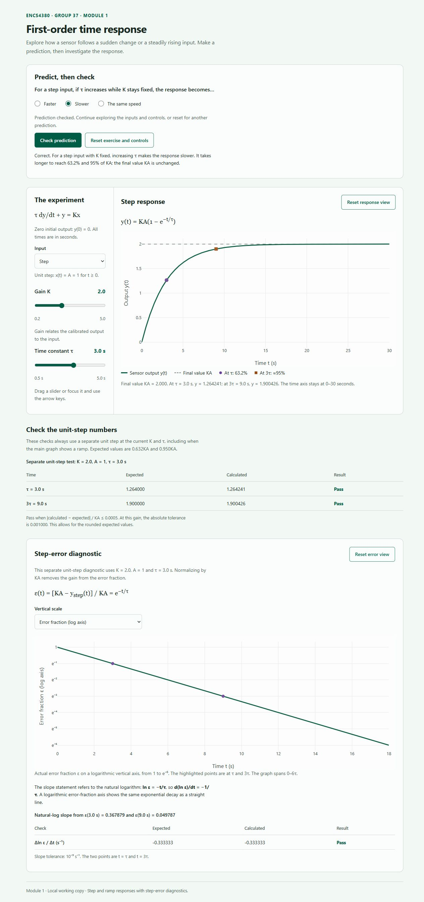
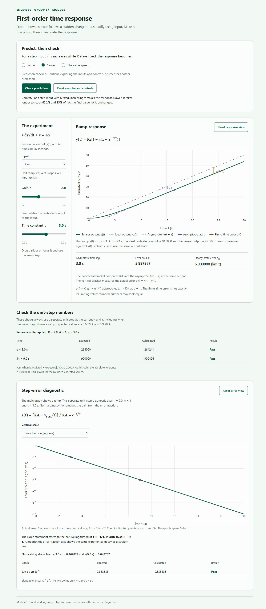

# ENCS4380 Dynamic Characteristics Toolkit - Group 37

This is the Module 1 implementation for Checkpoint 1 on Tuesday, 3 November 2026.

**Live website:** [Open the Dynamic Characteristics Toolkit](https://mohammad-sawafta.github.io/encs4380-dynamics-Group37/).

The [source repository](https://github.com/Mohammad-Sawafta/encs4380-dynamics-Group37) publishes automatically through GitHub Pages from the root of `main`, with HTTPS enabled. The website works directly in a browser without an account or a local server.

## Run locally

Open `index.html` in a web browser and keep the `css` and `js` folders beside it. An internet connection is needed to load the pinned Plotly.js library from its official CDN. No account, application backend, or build step is required.

For an optional local preview, run `python -m http.server 8000` from this folder and open `http://localhost:8000`. This only serves the static files for development; it is not a deployment requirement.

## Use Module 1

1. Choose a prediction before moving the experiment controls.
2. Change the time constant, then check your prediction.
3. Explore gain K and switch between a step and a ramp input.
4. Inspect the response markers, ramp lag, and dynamic error.
5. Switch the step-error diagnostic between a logarithmic error axis and a natural-log plot.
6. Read the expected values, calculated values, and pass/fail results.

The step amplitude is A = 1 input unit. The ramp slope is r = 1 input unit per second. The initial output is zero. Time is measured in seconds, and the controls use positive gain and a positive time constant.

## Equations and interpretation

The homework's model is `tau * dy/dt + y = K * x(t)`.

| Quantity | Formula |
| --- | --- |
| Step input | `x(t) = A` for `t >= 0` |
| Step output | `y(t) = K*A*(1 - exp(-t/tau))` |
| Ramp input | `x(t) = r*t` |
| Ideal calibrated ramp output | `K*x(t) = K*r*t` |
| Actual ramp output | `y(t) = K*r*(t - tau*(1 - exp(-t/tau)))` |
| Ramp asymptote | `K*r*(t - tau)` |
| Ramp dynamic error | `e(t) = K*x(t) - y(t) = K*r*tau*(1 - exp(-t/tau))` |
| Steady-state ramp error | `e_ss = K*r*tau` |
| Asymptotic ramp time lag | `tau` |
| Step error fraction | `epsilon = (K*A - y_step)/(K*A) = exp(-t/tau)` |
| Natural log of step error | `ln(epsilon) = -t/tau` |

The ramp error compares the measured output with **K times the input**. Subtracting the raw input from the output would mix gain error with dynamic lag when K differs from 1. A ramp does not have a finite final output; its error approaches the steady-state value while both ideal and actual outputs keep increasing.

The logarithmic diagnostic uses a separate unit-step experiment at the current K and tau, even when the main graph shows a ramp. The slope `-1/tau` refers to **ln(epsilon)** versus physical time. A plot of `log10(epsilon)` would instead have slope `-1/(tau*ln(10))`.

## Validation

Homework validation check 1 is shown on the page:

- `y(tau) / (K*A) = 0.6321205588`, approximately 0.632.
- `y(3*tau) / (K*A) = 0.9502129316`, approximately 0.95.

The step checks allow an absolute difference of 0.0005 in the normalized fraction because the homework values are rounded. Expected output values scale with K*A. These remain explicitly labeled step checks when the main input is a ramp.

To run the independent numerical checks with Node.js:

```sh
node tests/first-order.test.cjs
```

The tests compare the closed-form step and ramp outputs against an independent RK4 integration of the governing differential equation. They also check non-unit gains and input sizes, the ramp-error identity and limit, the asymptotic lag, and the natural-log slope. The numerical integrator is a development test, not a claimed bonus feature of the website.

Local verification on 2 November 2026: all 470 numerical assertions passed. Browser checks covered prediction feedback, slider limits, Step/Ramp switching, both diagnostic scales, repeated zoom/reset, and layouts at 1280, 390, and 320 pixels wide. No browser errors were reported.

Published-site verification on 2 November 2026: all five HTML, CSS, and JavaScript files loaded successfully and matched the reviewed files. Live browser checks passed at 390 and 320 pixels wide, including rendered graphs, prediction feedback, ramp values, the natural-log diagnostic, resets, and no horizontal page overflow or console errors. Mohammad also confirmed that the published website worked on a physical phone; the phone model and browser were not recorded.

## File responsibilities

| File | Responsibility |
| --- | --- |
| `index.html` | Content, controls, graph containers, and script loading |
| `css/styles.css` | Shared styling and responsive layout |
| `js/models/first-order.js` | Reusable equations, independent of the page and Plotly |
| `js/plotting.js` | Shared Plotly styling, rendering, and reset helpers |
| `js/module1.js` | Module 1 controls, graph data, prediction, and validation |
| `tests/first-order.test.cjs` | Independent numerical verification |

## Group members and planned ownership

Accounts verified from the repository owner and collaborator invitations on 1 November 2026:

- [Mohammad-Sawafta](https://github.com/Mohammad-Sawafta), repository owner.
- [Yanal Omar (yaniomar)](https://github.com/yaniomar), invitation pending at the time of the check.
- [Saifeddin Saleh (saifsaleh05)](https://github.com/saifsaleh05), invitation pending at the time of the check.

The following is the group's **planned ownership** for the remaining work. It is a plan, not a claim that every module is complete:

| Module | Planned owner | Current status |
| --- | --- | --- |
| Module 1 - first-order time response | Mohammad | Published on GitHub Pages; 470 numerical assertions passed and phone check confirmed |
| Module 2 - first-order frequency response | Yanal | Planned for Checkpoint 2; not implemented in this work |
| Module 3 - second-order response and state-space panel | Saif | Planned for Checkpoint 2; not implemented in this work |
| Module 4 - Guess the Sensor challenge | Mohammad | Planned for the final release; not implemented in this work |

Only Module 1 is currently published. Before submission, record the planned owners in the corresponding assigned GitHub Issues. Completed contributions must be confirmed from the actual files and commit history rather than inferred from this plan.

## Screenshots

Screenshots of the checked local implementation:





## AI assistance

AI assistance was used to help draft the interface and JavaScript, check equations, and prepare numerical tests. Team members need to review and understand the code and equations they submit and explain in the demo.

## Before the Tuesday checkpoint

- [x] Publish the reviewed files to the group repository and enable GitHub Pages.
- [x] Add the verified live website link here.
- [x] Check the live website on an actual phone.
- [ ] Confirm teammate and instructor access, and record module owners in assigned Issues.

The local files are not a substitute for the required five-minute check of the live Pages link.
